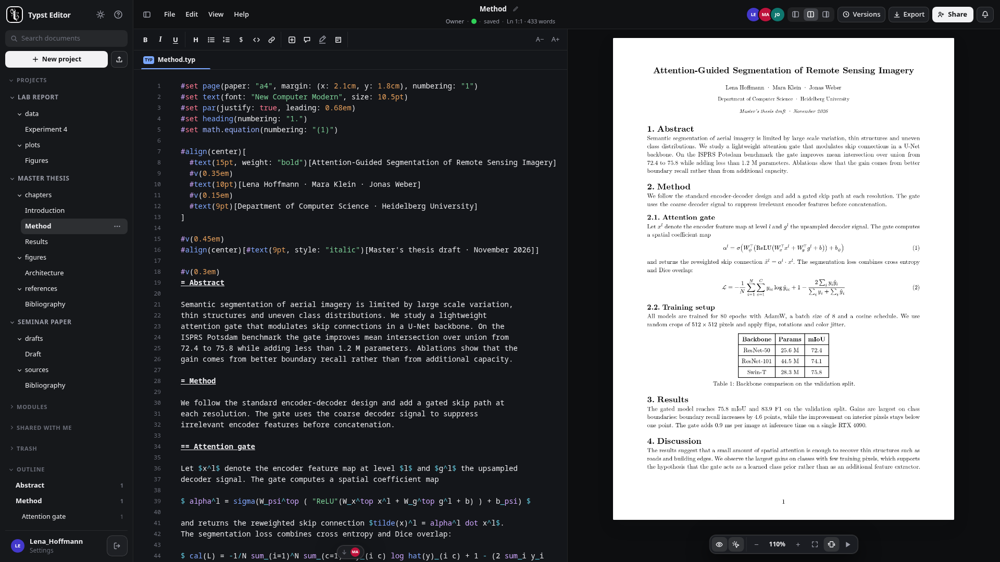

<p align="center">
  
</p>

<h1 align="center">Typst Editor</h1>

<p align="center">
  <strong>Collaborative Typst editing on your own server.</strong><br />
  Source and live PDF side by side, projects the whole team can work in, and review tools for people who shouldn't touch the source.
</p>

<p align="center">
  <a href="#installation"><strong>Install</strong></a> ·
  <a href="CONTRIBUTING.md">Contributing</a> ·
  <a href="SECURITY.md">Security</a> ·
  <a href="LICENSE">License</a>
</p>

<p align="center">
  <a href="https://github.com/fl-grtg/typst-editor/actions/workflows/ci.yml"></a>
  <a href="https://github.com/fl-grtg/typst-editor/actions/workflows/docker.yml"></a>
  <a href="./LICENSE"></a>
</p>

<a href="./.github/screenshot.png">
  
</a>

Typst Editor is a browser-based workspace for Typst documents that several people work on at once. Edits sync live, and the PDF is compiled in your own browser with Typst as WebAssembly, so there is no compile service to run or trust. On the server it is a single process: FastAPI for the API, Yjs for sync, SQLite for storage, and no Node at runtime.

- **Live editing and preview.** Everyone sees changes as they are typed, with presence indicators. The PDF rebuilds locally in each browser.
- **Projects, not loose files.** A project holds several documents that compile independently, plus shared modules, templates, bibliographies and attachments. Checkpoints let you compare versions and roll back.
- **Roles and review.** Owners, editors and reviewers. Reviewers read, comment on lines, @-mention people and propose changes; owners and editors decide what gets accepted. Mentions and proposals arrive in an inbox.
- **Export.** Each document as `.typ`, PDF, SVG or PNG, or a whole project as ZIP.
- **Agent access.** API keys with their own role and mode (direct, proposal or automatic) and an MCP endpoint for Claude Code, OpenCode and similar clients. Agents work on paths like `/Project/Folder/Document`, edit the live text without disturbing people typing, hand in changes as proposal packages that humans accept hunk by hunk, and move big files through one-time curl links. A short skill lives in `skills/typst-editor`.
- **Built for self-hosting.** Invite-only signup, per-user quotas and per-endpoint rate limits.

## Installation

You need Docker. Both setups keep data in a volume and listen on loopback only.

```bash
docker run -d --name typst-editor \
  --restart unless-stopped \
  -p 127.0.0.1:8978:8978 \
  -v typst-data:/app/data \
  ghcr.io/fl-grtg/typst-editor:main
```

Or with Compose: grab [`compose.yml`](https://raw.githubusercontent.com/fl-grtg/typst-editor/main/compose.yml) and start it.

```bash
curl -fsSLO https://raw.githubusercontent.com/fl-grtg/typst-editor/main/compose.yml
docker compose up -d
```

The image tracks the rolling `main` build, so run `docker compose pull` (or `docker pull`) before upgrading. To reach the app from other machines, change the port mapping and put a reverse proxy with TLS in front of it. For a locked-down container, the repo also ships `compose.hardened.yml`, an overlay with a read-only filesystem, dropped capabilities and `no-new-privileges`.

Open `http://127.0.0.1:8978` and sign up with the invite code from the logs:

```bash
docker logs typst-editor 2>&1 | grep "invite code"   # docker run
docker compose logs app | grep "invite code"         # docker compose
```

The code is generated on first start and saved to `DATA_DIR/.invite_token`. For a public server, set `REGISTRATION_INVITE_TOKEN` before the first start.

### Single Sign-On (OIDC)

To enable OpenID Connect login (Authentik, Authelia, Kanidm, etc.) using Authorization Code Flow with PKCE, set `OIDC_ISSUER_URL` and `OIDC_CLIENT_ID` (plus `OIDC_CLIENT_SECRET` for confidential clients, or leave it empty for public PKCE clients):

```dotenv
OIDC_ISSUER_URL=https://auth.example.com/application/o/typst/
OIDC_CLIENT_ID=typst-editor
OIDC_CLIENT_SECRET=
OIDC_REDIRECT_URI=https://typst.example.com/api/oidc/callback
```

Set `OIDC_REDIRECT_URI` explicitly in production. Optional settings (`OIDC_PROVIDER_NAME`, `OIDC_ALLOWED_GROUPS`, `OIDC_AUTO_REGISTER`, `OIDC_AUTO_REDIRECT`, `DISABLE_PASSWORD_LOGIN`) are documented in [`.env.example`](.env.example) and [`config.example.toml`](config.example.toml).

## Contributing

Small, focused changes are easiest to review; open an issue first for anything larger and run `make check` before a PR. Details are in [CONTRIBUTING.md](CONTRIBUTING.md), and security reports go through [SECURITY.md](SECURITY.md).

## License

Apache-2.0, see [LICENSE](LICENSE). Third-party components are listed in [NOTICE](NOTICE).