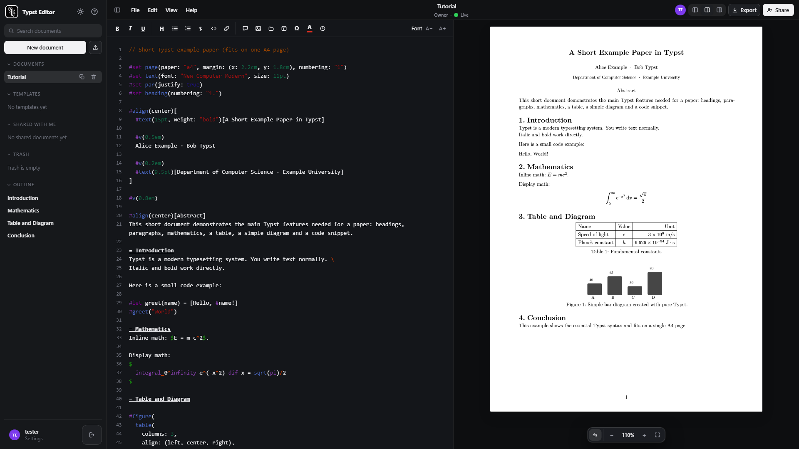

# 📝 Typst Editor

[](https://github.com/fl-grtg/typst-editor/actions/workflows/ci.yml) [](https://github.com/fl-grtg/typst-editor/actions/workflows/docker.yml) [](./LICENSE)

Collaborative Typst editor in the browser: code left, live PDF right.

One process: FastAPI serves the API, Yjs syncs edits, SQLite stores all. No Node at runtime.



## ✨ Features

- Live PDF preview, compiled in browser (Typst 0.15.1 via typst.ts 0.8.0-rc3 WASM, pdf.js render)
- Realtime collab via Yjs over `WS /ws/{doc_id}`, presence included, cookie-only auth
- Owner/editor/reviewer project roles (reviewer = read + comment + propose); legacy single-doc shares remain doc-scoped — a doc guest sees only that document plus its reachable sources, never the project member list or other docs
- Comment threads with line anchors, @-mentions, one-level replies, resolve, edit
- Outline from `=` headings, symbol picker, autocomplete (`#image`/`#include`), find/replace
- Images and generic file attachments via upload button or project drag & drop; clipboard images can be pasted into the editor
- Private module collection per account plus shared project library, reused via `#include`; no private fallback at compile time, local files win
- Project checkpoints: protected manual saves plus retained automatic saves (at most every 15 min), per-file compare, restore saves `Before restore` first
- Projects with multiple independently compilable docs, shared modules/attachments, two-stage trash (project archived until its last doc is hard-deleted), copy/move/duplicate, search over titles + content
- Per-document export `.typ`, PDF, SVG, PNG; document source ZIP vs project ZIP (see below) with no full project round-trip promise
- Yjs live sync with write-behind flush (nominal ~2 s interval + on last disconnect; no guaranteed loss bound — failed flushes, quota blocks or load can delay persistence), 24 h local stash with opt-in restore (no merge guarantee), plain HTTP cache without service worker, font/zoom/theme settings
- Account settings: avatar (PNG/JPEG/WebP, 200 KB), rename, password change, delete
- Per-user quotas (private originals and project copies counted separately toward the owner; effective limit is `quota.user_cap` = configured cap + one-time `migration_bytes` allowance for the existing project library, visible via `GET /api/me` `storage{used,limit,migration_allowance}` + Settings) + per-endpoint rate limits, enforced server-side

## 🚀 Get Started

Docker (no config needed):

```bash
docker compose up -d
docker compose logs app | grep "invite code"
# Windows PowerShell: docker compose logs app | Select-String "invite code"
```

Pulls the image (`pull_policy: always`). Data stays in a managed volume. Host path instead: set `COMPOSE_DATA_PATH` (Linux/macOS/WSL: `chown -R 999:999` on it).

Sign up at `http://127.0.0.1:8978` with the invite code from the logs. Custom setup only: `cp .env.example .env`. Custom port: set `PORT` in `.env` (moves host + container port). Build local: `docker build -t ghcr.io/fl-grtg/typst-editor:main .`.

Local Python 3.11:

```bash
python -m venv .venv
.venv\Scripts\activate  # Windows (source .venv/bin/activate on Linux/macOS)
pip install -r requirements.txt
uvicorn backend.main:app --host 127.0.0.1 --port 8978 --workers 1
```

Registration is `invite-only`. Fresh Docker installs print a token on first start (stored `chmod 600` as `DATA_DIR/.invite_token`). Every account needs it. Public servers: set `REGISTRATION_INVITE_TOKEN` before first start (`openssl rand -hex 32`). Empty token blocks registration (fail-closed). `open` is for local tests only.

## ⚙️ Configuration

File + env overrides; env wins. Parsed in `backend/config.py`. `.env.example`/`config.example.toml` mirror it.

| ENV | Default | Notes |
| --- | --- | --- |
| `DATA_DIR` | `./data` | SQLite + uploads; `/app/data` in container. |
| `COMPOSE_DATA_PATH` | managed volume | Host path instead, e.g. `/srv/typst-data`. |
| `TRUST_PROXY` | `false` | Set `true` behind a proxy, else cookies break. |
| `FORWARDED_ALLOW_IPS` | `127.0.0.1,::1` | Peers allowed to send `X-Forwarded-*` (CIDR ok); same value goes to uvicorn. Never `*` with `TRUST_PROXY=true` (refuses to start). |
| `REGISTRATION` | `invite-only` | `closed`, `invite-only`, or `open`. |
| `REGISTRATION_INVITE_TOKEN` | empty | Min 16 chars when set, else start refuses. |
| `SESSION_SECONDS` | `1209600` | 14 days. |
| `MAX_DOCS_PER_USER` | `100` | Plus `MAX_BYTES_PER_USER` (default 500 MB) and `MAX_FILES_PER_DOC` (default 200). Private originals and project copies count separately toward the owner. Effective limit is `quota.user_cap` = cap + one-time `migration_bytes` (v19, existing project library in bytes); `GET /api/me` reports `storage{used,limit,migration_allowance}`. |

Never commit `config.toml` or `.env`; only `.example` files are tracked.

## 📡 API

```bash
curl -s http://127.0.0.1:8978/healthz
```

Sync runs over `WS /ws/{doc_id}` (y-websocket). Browser auth is cookie-based (`typst_session`, HttpOnly, SameSite=lax); agents use Bearer API keys (see below). Invite tokens go in the POST body, never in the URL. `/?join=TOKEN` and `/?invite=CODE` are entry links only: the app reads the code, strips it from the URL, sends it via POST.

### 🔗 Invite links

- `https://host/?invite=CODE` opens registration with code prefilled (no auto-submit). Needs logged-out browser.
- `https://host/?join=TOKEN` redeems a doc invite after login. Share via doc Share button.

### 🔑 API keys + MCP

Keys look like `tpe_<8hex>_<32hex>` (only the sha256 hash is stored; the secret is shown once at creation in Settings). Roles: `reviewer` (read + comment + propose, least privilege) or `editor` (default); `expires_in_days` optional (1–365, default never).

```bash
curl -cj jar.txt -b jar.txt -X POST http://127.0.0.1:8978/api/keys \
  -H 'Content-Type: application/json' -d '{"name":"agent","role":"reviewer","expires_in_days":90}'
curl -s -b jar.txt http://127.0.0.1:8978/api/keys
curl -s http://127.0.0.1:8978/api/keys -H "Authorization: Bearer tpe_..."
```

Claude Code: `claude mcp add --transport http typst-editor http://127.0.0.1:8978/mcp --header "Authorization: Bearer tpe_..."`

OpenCode (`opencode.json`): server `"typst-editor"` with `"type": "remote"`, `"url": "http://127.0.0.1:8978/mcp"`, `"headers": {"Authorization": "Bearer tpe_..."}`.

Agent loop `ls -> read -> edit -> view -> fix`; see `skills/typst-editor/SKILL.md` for the path model and edit rules. Project paths are `/projects/{id}/docs/{Title}/...` and `/projects/{id}/resources/...`; legacy `/docs` and `/shared` paths stay as compatible aliases. Ambiguous legacy titles fail with `409` (use the project path); trashed docs and retired folder routes fail with `410`. Note: `view` returns native image blocks (longest side ≤1280px) + `count`/`cache_hit`/`last_seen` — update server and skill together, the old base64 `pages[]` field is gone.

## 💾 Backup

```bash
python scripts/backup.py --include-files
```

Writes `DATA_DIR/backup/app-YYYYMMDD-HHMMSS.db` (`VACUUM INTO`) + `*-files.tar.gz` of `DATA_DIR/files`. Keeps newest 7 (`--keep N`, `--dry-run` to preview). `--keep 0` still keeps 1. Cron: `docker compose exec -T app python scripts/backup.py --include-files`. Backups are plain: `gpg -c DATA_DIR/backup/app-*.db`.

DB dump and files archive are two separate steps with no shared consistent point under writes. Create backups in a maintenance window (stop the server or ensure no writes during the run); the same applies to restore. The automatic DB migration backup covers the database only, not attachments. Source/document ZIPs (`export.zip`, document `zip`, project `export-zip`) are not server backups.

Restore: stop server, copy backup DB + files from the same maintenance window over `app.db`, delete `app.db-wal`/`app.db-shm`, unpack files (`tar -xzf ... -C DATA_DIR`), `chown -R 999:999 DATA_DIR` on host paths, start. Check with `PRAGMA integrity_check;`.

## 🔌 Reverse proxy

Needs `TRUST_PROXY=true`. Never expose directly; TLS is yours. Caddy:

```
typst.example.com {
    encode zstd gzip
    reverse_proxy 127.0.0.1:8978
}
```

nginx (WebSocket needs `http_version 1.1` + `Upgrade`/`Connection`):

```
server {
    listen 443 ssl;
    server_name typst.example.com;
    ssl_certificate /etc/letsencrypt/live/typst.example.com/fullchain.pem;
    ssl_certificate_key /etc/letsencrypt/live/typst.example.com/privkey.pem;

    client_max_body_size 12M;

    gzip on;
    gzip_comp_level 5;
    gzip_types application/javascript application/wasm application/json text/css image/svg+xml;

    location / {
        proxy_pass http://127.0.0.1:8978;
        proxy_http_version 1.1;
        proxy_set_header Host $host;
        proxy_set_header Upgrade $http_upgrade;
        proxy_set_header Connection "upgrade";
        proxy_set_header X-Forwarded-Proto $scheme;
        proxy_set_header X-Forwarded-For $proxy_add_x_forwarded_for;
        proxy_read_timeout 86400s;
        proxy_send_timeout 86400s;
        proxy_buffering off;
    }
}
```

Compression matters: the compiler (JS + WASM) is about 72 MB raw and about 26 MB compressed, so keep `encode`/`gzip` on. Without those headers the sync socket stays dead. `client_max_body_size 12M` covers 10 MB uploads. Custom `PORT`: point proxy at that port.

Uvicorn trusts `X-Forwarded-For`/`Proto` only from `FORWARDED_ALLOW_IPS` (default `127.0.0.1,::1`). Behind compose the proxy uses a `172.x` IP, so extend the default: `FORWARDED_ALLOW_IPS=127.0.0.1,::1,172.16.0.0/12`. Else all clients share one rate-limit bucket. Never `*` with `TRUST_PROXY=true`.

One worker (`--workers 1`), one replica: rooms live in memory; multi-worker exits on purpose. 512 MB min, 1 GB advised. No public demo; self-host.

Project checkpoints need editor rights (read/compare for readers); restore saves a `Before restore` copy first. Removing a project member also deletes that member's doc shares in the project and — because invite links carry no username — wipes all pending invites of all project docs (broad revoke). The remove dialog states this broad effect explicitly before confirming (`projects.removeMemberWarning`, implemented in the share UI); per-invite attribution would need a migration and is out of prerelease scope. Project titles are unique per owner case-insensitive (v19 `idx_projects_owner_title_nocase`): create auto-suffixes (`Title (2)`…, truncated to 100 chars), rename rejects collisions with `409`, existing collisions were suffixed once during migration. File/resource rename is two-step: `POST /api/projects/{id}/rename-entry-preview` returns `{name, version, references}`, `POST /api/projects/{id}/rename-entry` requires that `version` (`409` on stale state); the UI shows the static references + dynamic-path hint and asks for confirmation before renaming (no automatic reference rewrite). Over-quota migration state stays readable/exportable/deletable; v19 grants a one-time permanent `migration_bytes` allowance (size of the existing project library in bytes at migration time, `user_cap` = cap + allowance, no recurring grant for new copies): new writes fail with `413` until space is freed.

Limits: 200000 UTF-8 bytes per doc (`MAX_TXT` in `backend/constants.py`); doc titles unique per project NOCASE + project titles unique per owner NOCASE, each 100 chars (project create auto-suffixes, document-create/project-rename collisions → `409`; v19 suffixed existing project collisions once); file/resource rename needs the `version` from `rename-entry-preview` (`409` on stale state); uploads 10 MB per file; manual project checkpoints stay protected, automatic checkpoints retain the newest 10 plus one per week within 5 weeks and the creation checkpoint (legacy per-doc snapshots keep their 50-cap), auto at most every 15 min; invites valid 7 days, max 20 per doc, multi-use (token shown once); search needs 2 chars, max 20 hits, docs + reachable project resources; default quotas 100 docs + 500 MB per user, 200 files per doc (see Configuration); avatars 200 KB; exports capped at 100 MB, files over 10 MB go to `SKIPPED.txt`; old folder routes answer `410`, ambiguous legacy MCP titles answer `409`; reads share `files_list` bucket (120/min); MCP calls share the `mcp` bucket (60/min).

### 🔒 Security Contact

Report vulns via GitHub Private Vulnerability Reporting.
No public issues for security problems.
Allow time for a fix before disclosure.

No CDN for code delivery (local `vendor/` bundle; no service worker since 2026-10-03, plain HTTP cache). First load works offline except `@preview` package fetches from `packages.typst.org`. Pins: typst.ts 0.8.0-rc3 = bundled Typst 0.15.1 = CLI 0.15.1 (RC on purpose — latest stable 0.7.0 still bundles Typst 0.14.2, only the RC bundles 0.15.1); pdf.js 3.11.174, yjs 13.6.27, y-websocket 1.5.0. View cache is salted with `typst --version`, so CLI bumps auto-bust it. Afterwards the shell stays in browser cache; saving needs net (24 h stash with opt-in restore, no merge guarantee). `Cache-Control: no-store` on `/`, `*.html`, `*.js`, `/api/*` (see `backend/main.py`); versioned assets (`vendor-cm.js`, `manifest.json`, icons) are `immutable`. CSP needs `unsafe-inline`/`unsafe-eval`/`wasm-unsafe-eval` for Typst WASM; user content renders via `textContent` only. No broad security certification is claimed.

### 🛠 Troubleshooting

- First load is self-hosted; only `@preview` packages need net (`packages.typst.org`). Check console.
- Single worker only (`--workers 1`). Multi-worker exits on purpose.
- Behind proxy: `TRUST_PROXY=true`.
- Port `8978` is loopback-only (override via `PORT`); TLS via proxy.
- Host path perms only: `chown -R 999:999` on it.
- `429` on reads: shared `files_list` bucket (120/min), slow down. `429 Export already running`: per-user export lock, wait and retry once.
- `410`: trashed doc (restore first) or retired folder route (use projects). `409`: name/version conflict — re-read, rename, or use the project path for ambiguous MCP titles.

### 🧪 Develop

```bash
pip install -r requirements-dev.txt
python -m pytest
ruff check backend/ scripts/ tests/
mypy backend/ scripts/ tests/
```

Vendor bundle (`cm-build/` → `vendor-cm.js`): `cd cm-build && npm ci && npm run build`. CI fails on diff or >700 KB.

### 📦 Changelog

Version `0.2.0rc1` (`pyproject.toml`) is a prerelease candidate, not yet published. See `RELEASE_NOTES.md` (candidate draft: breaking changes + limits, no full acceptance claimed) and, once published, GitHub Releases.

## 🛠 Development

```bash
pip install -r requirements.txt -r requirements-dev.txt
make dev      # run locally with reload
make check    # ruff + mypy + frontend build check + tests
```

The frontend source lives in `web/`; `index.html` is generated (`python web/build.py`). Backend routers are in `backend/routers/`.
See [CONTRIBUTING.md](CONTRIBUTING.md), [SECURITY.md](SECURITY.md) and [CODE_OF_CONDUCT.md](CODE_OF_CONDUCT.md).

## 💡 Why

Most collab editors need heavy infra or lock you into a cloud. This is one container you self-host: enough collab to work together, small enough to read in one sitting.

## 📜 License

Apache-2.0, see `LICENSE`. Third-party versions in `NOTICE` (pins match the vendored bundle and CSP).

## Modules and source bundles

Project modules, private modules and document-local text files support `.typ`, `.bib`, `.csv`, `.tsv`, `.json`, `.yaml`/`.yml`, `.toml`, `.xml`, `.csl`, and `.txt`. CSV/TSV use a cell editor; BibLaTeX offers a source list and form alongside the raw editor. Structured data editors highlight syntax and validate their content. At compile/export time there is no private fallback: project library + document-local files only, local files win; private modules enter a project only via explicit pull/copy as independent copies.

Use **Export → Source ZIP** for a document bundle (`main.typ` + sources at their original relative paths + `SKIPPED.txt` when oversized files were left out). Upload that ZIP to create a new document in a project: every bundled module becomes a document-local file. Bundles must contain exactly one `main.typ`; nested paths are preserved. Import accepts at most 10 MB compressed and 100 MB unpacked, with the usual per-file limits (200 KB text, 10 MB binary) and configured file-count/quota limits.

Project ZIP (`GET /api/projects/{id}/export-zip`) is a different layout: `project.json` + `modules/…` + `documents/<doc-id>/main.typ` (+ `skipped.json` per doc when needed), limited to what the caller may see. It has no matching full-project importer, so no complete project round-trip is promised; use it for inspection/backup of sources, not as server backup.


### Local review and attachment changes

The editor's **Suggest** mode gives project members a tracked draft spanning
documents, modules and attachments. `/api/projects/{id}/proposals` lists and
creates packages; `PATCH /{package_id}` corrects a versioned package and
`POST /{package_id}/accept` accepts all changes, a file, or a passage. Reviewers
can propose; owners/editors decide. Large local drafts are stored in IndexedDB.

Document-only guests keep the separate tracked text draft. Sending creates up
to 50 non-overlapping proposals atomically;
`POST /api/docs/{id}/suggestions/batch` accepts a `changes` list with `old_string`,
`new_string`, and optional `text`. Owner/editor decisions use
`POST /api/docs/{id}/suggestions/{suggestion_id}/accept` or `/reject`.
Acceptance checks the current original text and applies a Yjs edit; proposals
never grant source-write permission to reviewers. Stale originals return `409`.

Spelling language is account-wide (`auto`, `de`, `en`, `off`), saved by
`POST /api/me/preferences` with `spell_language` and returned by `GET /api/me`.
Migration 20 adds suggestion metadata; migration 21 adds the account preference.
Migrations 22–25 add recoverable file/module trash, project proposal packages,
the trash index and explicit checkpoint retention kinds. Ambiguous legacy
checkpoints remain protected from automatic pruning.

Project drag-and-drop and the main upload control accept arbitrary attachment
extensions (10 MB per binary attachment). Text-source limits remain 200 KB.
Downloads use attachment disposition and `nosniff`; generic files are not text
editors. Images open in the image viewer. Path traversal remains rejected.
